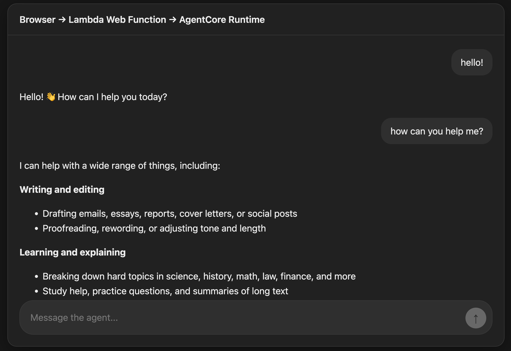
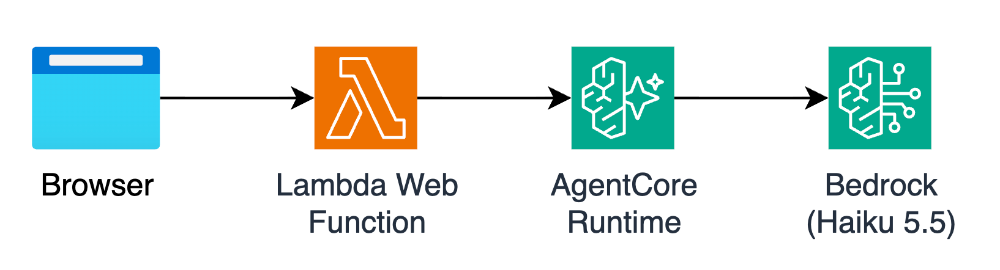

# Lambda Web Function → AgentCore Runtime


Agentic chat app hosted on an [AWS Lambda Web Function](https://docs.aws.amazon.com/lambda/latest/dg/web-functions.html), backed by a [Strands](https://strandsagents.com) agent running on **Amazon Bedrock AgentCore Runtime**. 



The agent's response is streamed token by token from the model, through AgentCore Runtime and the Web Function, to the browser.

## Architecture



## Prerequisites

- AWS CLI v2, configured with credentials for the target account (used to log in to ECR when pushing the agent image)
- Terraform
- Docker (builds the agent's `linux/arm64` image)
- Node.js 24 and npm
- Access to Claude Haiku 5.5 in Amazon Bedrock. The agent uses the `us.anthropic.claude-haiku-5-5` cross-Region inference profile, so deploy to a US Region. Change `agent_model_id` in `terraform/agentcore_runtime.tf` to use a different model.
- For local development only: Python 3.13, [uv](https://docs.astral.sh/uv/), and [nodemon](https://nodemon.io)

## Deploy

```bash
make deploy
```

Once provisioning completes, Terraform prints the chat UI's URL:

```
webapp_url = "https://<endpoint-domain>.lambda-web.<region>.on.aws/"
```

The UI asks for a login secret, generated on deploy and stored in Secrets Manager. Retrieve it with:

```bash
make get-demo-secret
```

## Security considerations

This is a sample, not a production-ready deployment:

- To protect this demo from unauthorized access, the web app requires you to enter the secret randomly generated at deploy. *This is not a replacement for user authentication*. Make sure you always add real authentication with Cognito, Okta or similar, as well as rate limit (`throttle_config.rate_limit` on the endpoint in `terraform/webapp.tf`) prior to taking your applications to production. When using Web Function for APIs only (no web UI), use SigV4 authentication mode. 
- Each visit to the demo page generates a new AgentCore session, created by `/connect` and is NOT persisted across reloads. The agent is stateless and keeps no conversation history.
- To minimize token consumption, both input and output are capped. Prompts are limited to 100 characters, and the model's output is capped at 200 tokens.

## Teardown

```bash
make destroy
```
